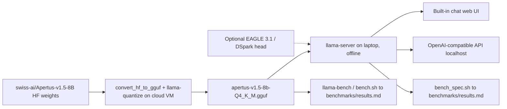

# Architecture

## Components

| Component | Role | Where it runs |
| --- | --- | --- |
| `swiss-ai/Apertus-v1.5-8B` (Hugging Face) | Source weights, BF16 safetensors (gated) | downloaded on a cloud VM |
| `scripts/convert_quantize.sh` (`convert_hf_to_gguf.py` + `llama-quantize`) | Convert the language model to an F16 GGUF, then quantize to 4-bit (Q4_K_M, Q4_0) | cloud VM (the F16 file is about 16 GB) |
| `apertus-v1.5-8b-Q4_K_M.gguf` | The single file copied to the laptop (about 5 GB) | laptop |
| `llama-server` (llama.cpp) | Built-in chat web UI and OpenAI-compatible API on localhost | laptop, offline |
| `llama-bench` + `scripts/bench.sh` | Speed measurements, one row per run in `benchmarks/results.md` | laptop (and VM, labelled) |
| EAGLE 3.1 / DSpark heads (phase 5, experimental) | Speculative drafters running on the target model's hidden states | laptop, inside llama.cpp; plain CPU serving is faster in the recorded laptop comparison |

## Data flow

Only the target GGUF and, for experiments, a draft GGUF cross from the VM to the
laptop. Everything on the laptop runs from local files; after setup, no network
access is needed.

## Why llama.cpp

- It is the most mature CPU inference engine and supports 4-bit GGUF quantization
  with hand-tuned AVX2 / AVX-512 kernels, which is what the i5-1135G7 offers.
- `llama-server` ships a chat web UI and an OpenAI-compatible API in one binary, so
  workshop participants need no extra software.
- It has an `apertus` architecture (added for Apertus v1, including the xIELU
  activation and QK-norm). v1.5 needs a small extension, see below.
- `llama-bench` gives reproducible prompt and generation throughput numbers.

## Apertus v1.5 support

### What changed from v1

Upstream llama.cpp only knows `ApertusForCausalLM` (v1). The v1.5 checkpoint is
`Apertus1p5ForConditionalGeneration` (`model_type: apertus1p5`), a multimodal wrapper.
Compared with the reference implementation (Swiss AI transformers fork
`feature/apertus_1p5_pipeline` @ `3797303`, the code inside the official
`ghcr.io/swiss-ai/vllm_apertus_1.5_release` image):

| Item | v1.5 | Same as v1? |
| --- | --- | --- |
| Decoder | 32 layers, hidden 4096, 32 query / 8 KV heads, head dim 128, pre-norm RMSNorm, QK-norm | yes |
| MLP | up/down projections with xIELU (per-layer `alpha_n`, `alpha_p`, `beta`, `eps`), intermediate 21,504 | yes |
| RoPE | llama3 scaling, theta 4,000,000, factor 32, original context 8,192 (NEOX-style `rotate_half`) | yes (now under `rope_parameters`) |
| Weight names | `model.language_model.*` and `lm_head.weight`; vision and audio tokenizers under `model.vision_tokenizer.*`, `model.audio_tokenizer.*` | no |
| Config | text settings nested under `text_config` | no |
| Vocabulary | **untied and split**: input embedding 266,752 rows (131,072 text + image codebook at 131,272 + audio codebook at 262,344), output head 131,072 rows (`output_vocab_size`) | no |
| Chat format | new template (`<|system_start|>`, `<|assistant_start|>`, deliberation and tool sections); end of turn `<|assistant_end|>` (68) | no |

### How it is handled

We build from a community branch, then apply the three speculative decoding patches
in `patches/`:
[`MichelRosselli/llama.cpp` @ `model/apertus-v1.5-refresh-20260914`](https://github.com/MichelRosselli/llama.cpp/tree/model/apertus-v1.5-refresh-20260914),
pinned at commit `442b0444` in `scripts/setup_llamacpp.sh`. It is 7 commits on top of
upstream `b11347`, which already contains the DSpark drafter (`--spec-type draft-dspark`,
upstream #25173), so the same build serves phases 2 to 5. Split-vocabulary work is
tracked in ggml-org/llama.cpp#26226. The pinned branch:

- registers `Apertus1p5ForConditionalGeneration` in the converter, reads `text_config`,
  maps `model.language_model.*`, and ignores the vision and audio tokenizers for the
  text GGUF;
- writes `apertus.vocab_size_out = 131072`, loads a 131,072-row output head next to the
  full 266,752-row embedding, and pads the logits of non-text tokens with -inf;
- adds the v1.5 chat template and tool-call parser, and sets `<|assistant_end|>` as
  EOS/EOT.

Not used here: its vision/audio (`mtmd`) support. Patch 0001 exposes the Apertus
`t_layer_inp` hidden states needed by both draft heads.

### Validation against the reference

`scripts/check_logits.py` runs the reference decoder layers one at a time (weights
streamed from safetensors, about 3 GB of RAM for the 8B model) and compares last-token
logits with `llama-debug` on the GGUF. On a synthetic checkpoint with the exact v1.5
layout (2 small layers, real 266,752-token vocabulary and tokenizer, real vision/audio
tokenizer shapes), the F16 GGUF matched the reference with NMSE 1.8e-6, KL 1.5e-6,
identical top-10 and identical tokenization; non-text logits were masked; `rope_freqs`
matched the reference llama3 frequencies to 1e-7.

On the real weights (revision `0be762a6`, prompt "The capital of Switzerland is", 6
tokens), against the reference:

| GGUF | NMSE | KL | Top-1 | Top-10 overlap |
| --- | --- | --- | --- | --- |
| F16 | 7.4e-8 | 3.4e-8 | same | 10/10 |
| Q4_K_M | 5.2e-3 | 3.2e-3 | same | 8/10 |

Tokenization matched, the 135,680 non-text logits were masked, and `llama-cli` gave a
coherent answer. The GGUF has `add_bos=true` and llama-server adds exactly one `<s>`
before the rendered chat template.

### Quantization choices

`scripts/convert_quantize.sh` keeps the output head and the token embedding at Q6_K in
every variant. The head is read for every generated token, and the reference post below
measured a 6 to 11% quality loss from 4-bit embedding and head. The embedding costs disk
space only: rows are looked up, not multiplied.

## Speculative decoding (DSpark and EAGLE 3.1, experimental)

A draft head reads the target model's hidden states and proposes the next few tokens;
the target verifies them in one batched forward pass and keeps the matching prefix. The
pinned llama.cpp already runs both head types (`--spec-type draft-dspark`, upstream
#25173, and `--spec-type draft-eagle3`), so phase 5 adapts them to Apertus instead of
porting heads. Both drafts were trained on the same thinking-off data and accept about
equally often.

| | DSpark (`...-DSpark-e10-thinking-off`) | EAGLE 3.1 (`...-EAGLE3.1-e10-thinking-off`) |
| --- | --- | --- |
| Trainer | Speculators `7046ac6` | TorchSpec `6c042a8` |
| Layers | 5 Qwen3-style layers (sliding window 2,048), about 1.7B parameters | 1 Llama layer, 294M parameters, plus a copy of the target's output head |
| Target features | inputs of layers 1, 8, 15, 22, 29 (`fc` + `hidden_norm`), attended as extra K/V | inputs of layers 2, 16, 29, each RMS-normed (`fc_norm`), then `fc` |
| Drafting | one pass over `[last token, mask x 7]`, Markov head chains the slots | one pass per draft token, feeding back its own normed hidden state |
| Shared with the target | token embedding and output head | token embedding |

What was needed on our side (`patches/`, applied by `scripts/setup_llamacpp.sh`):

1. the Apertus graph records its layer inputs (`t_layer_inp`), which both drafts read;
2. DSpark converter: identity `d2t` for the 131,072-token draft vocabulary, the llama3
   `rope_freqs` the Qwen3 path dropped, the block-causal mask it was trained with, and
   reuse of the Apertus vocabulary;
3. EAGLE 3.1: per-target `fc_norm` and `norm_output` in the graph (as in TorchSpec and
   the Swiss AI vLLM fork), identity `d2t` and full-vocabulary tokenization in the
   converter.

Both conversions match their references on the first draft after a chat prompt (F16
target and draft): `scripts/check_dspark.py` against the Speculators code (8/8 slots,
identical top-3, at most 6e-4 difference in the top-1 probability) and
`scripts/check_eagle3.py` against the TorchSpec / vLLM math (5/5 steps, identical
top-3, at most 5e-4).

### Why the speedup is small on a CPU

On a GPU, verifying several drafted tokens costs almost the same as generating one,
and the draft is cheap next to the target, so these heads reach 2.4x to 2.7x. On 4 CPU
cores, verifying 4 tokens costs about 1.4 target steps, and one draft round costs about
one more: DSpark reads its 1 GB of layers plus the 0.44 GB output head once; EAGLE reads
its small layer plus its own copy of the head once per drafted token. With about 2.5
tokens accepted per round, DSpark reached about 1.2x on the cloud VM; EAGLE reached
about 1.4x after quantizing its own output head to Q4_0 (see `benchmarks/results.md`).

These gains do not hold on the reference laptop. The 6 November CPU chat comparison
measured 5.82 tok/s without a draft and 5.38 with EAGLE k=3 (about 8% slower).
Full-offload Iris Xe Vulkan measured 3.55 without a draft and at best 4.58 with
EAGLE k=1. The working default remains Q4_K_M on CPU with 4 threads and no draft.
Cloud VM results describe that machine only.

The serving path stays the same: `scripts/serve_spec.sh` is `scripts/serve.sh` plus the
draft (`--model-draft`, `--spec-type`, `--spec-draft-n-max`). Both target and draft
default to zero GPU layers. `BUILD_DIR` selects a different build, and explicit
`--n-gpu-layers` / `--n-gpu-layers-draft` flags enable the optional Vulkan path.

## References

- Digital Pathlines, [Shrinking Apertus 1.5 8B for an 8 GB Laptop GPU](https://digitalpathlines.ch/2026/08/12/shrinking-apertus-1-5-8b-for-an-8-gb-laptop-gpu/)
  (Aug 2026). A GPU + vLLM deployment, so its numbers are not directly comparable to
  this CPU + llama.cpp setup. What we take from it:
  - v1.5 is a new, multimodal architecture (vision and audio tokenizers). Stock runtimes
    do not support it; Swiss AI ships a patched vLLM image
    (`ghcr.io/swiss-ai/vllm_apertus_1.5_release`). Its modeling code is the reference
    implementation for our text-only conversion, and logits are compared against it.
  - Text-only use: we extract only the language model into the GGUF.
  - The vocabulary is untied: 266,752 embedding rows and 131,072 output-head rows. The
    output head is read on every generated token, so it stays at Q6_K or better
    (llama.cpp's Q4_K_M already does this); 4-bit embedding and head cost them 6 to 11%
    on agent benchmarks.
  - Speed: 5 to 5.6 tok/s with about 4B parameters offloaded to system RAM, in line with
    our 6 to 8 tok/s CPU estimate.
  - Long prompts are slow (30K tokens took 199 s even partly on GPU): keep the default
    context at 4K to 8K tokens.
  - Native tool calling was weak; chat, translation and document Q&A worked well. The
    workshop demo shows chat and document Q&A.
  - They hit a server deadlock likely caused by a dependency mismatch: pin the
    llama.cpp commit and test a long run of requests before the workshop.

## Participant distribution

`launch.sh` manages a single local `serve.sh` child and opens the embedded UI only
after readiness. Packaged binaries and CPU backend modules live in
`runtime/<backend>/bin/`; model files remain separate. macOS/Linux share Bash 3.2
compatible detection, checksum and lifecycle code. The Mac app is a small native
entry point that keeps models/logs outside its signed bundle. See
[DISTRIBUTION.md](DISTRIBUTION.md). Auto Metal remains gated on actual Apertus
validation; CPU is the baseline.
