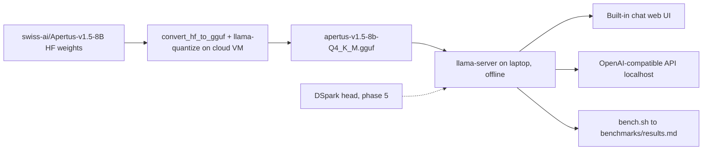

# Architecture

## Components

| Component | Role | Where it runs |
| --- | --- | --- |
| `swiss-ai/Apertus-v1.5-8B` (Hugging Face) | Source weights, BF16 safetensors (gated) | downloaded on a cloud VM |
| `scripts/convert_quantize.sh` (`convert_hf_to_gguf.py` + `llama-quantize`) | Convert the language model to an F16 GGUF, then quantize to 4-bit (Q4_K_M, Q4_0) | cloud VM (the F16 file is about 16 GB) |
| `apertus-v1.5-8b-Q4_K_M.gguf` | The single file copied to the laptop (about 5 GB) | laptop |
| `llama-server` (llama.cpp) | Built-in chat web UI and OpenAI-compatible API on localhost | laptop, offline |
| `llama-bench` + `scripts/bench.sh` | Speed measurements, one row per run in `benchmarks/results.md` | laptop (and VM, labelled) |
| DSpark head (phase 5) | Speculative drafter running on the target model's hidden states | laptop, inside llama.cpp |

## Data flow

Only the GGUF file crosses from the VM to the laptop. Everything on the laptop runs
from local files; after setup, no network access is needed.

## Why llama.cpp

- It is the most mature CPU inference engine and supports 4-bit GGUF quantization
  with hand-tuned AVX2 / AVX-512 kernels, which is what the i5-1135G7 offers.
- `llama-server` ships a chat web UI and an OpenAI-compatible API in one binary, so
  workshop participants need no extra software.
- It has an `apertus` architecture (added for Apertus v1, including the xIELU
  activation and QK-norm). v1.5 needs a small extension, see below.
- `llama-bench` gives reproducible prompt and generation throughput numbers.

## Apertus v1.5 support

### What changed from v1

Upstream llama.cpp only knows `ApertusForCausalLM` (v1). The v1.5 checkpoint is
`Apertus1p5ForConditionalGeneration` (`model_type: apertus1p5`), a multimodal wrapper.
Compared with the reference implementation (Swiss AI transformers fork
`feature/apertus_1p5_pipeline` @ `3797303`, the code inside the official
`ghcr.io/swiss-ai/vllm_apertus_1.5_release` image):

| Item | v1.5 | Same as v1? |
| --- | --- | --- |
| Decoder | 32 layers, hidden 4096, 32 query / 8 KV heads, head dim 128, pre-norm RMSNorm, QK-norm | yes |
| MLP | up/down projections with xIELU (per-layer `alpha_n`, `alpha_p`, `beta`, `eps`), intermediate 21,504 | yes |
| RoPE | llama3 scaling, theta 4,000,000, factor 32, original context 8,192 (NEOX-style `rotate_half`) | yes (now under `rope_parameters`) |
| Weight names | `model.language_model.*` and `lm_head.weight`; vision and audio tokenizers under `model.vision_tokenizer.*`, `model.audio_tokenizer.*` | no |
| Config | text settings nested under `text_config` | no |
| Vocabulary | **untied and split**: input embedding 266,752 rows (131,072 text + image codebook at 131,272 + audio codebook at 262,344), output head 131,072 rows (`output_vocab_size`) | no |
| Chat format | new template (`<|system_start|>`, `<|assistant_start|>`, deliberation and tool sections); end of turn `<|assistant_end|>` (68) | no |

### How it is handled

We build from a community branch instead of patching llama.cpp ourselves:
[`MichelRosselli/llama.cpp` @ `model/apertus-v1.5-refresh-20260914`](https://github.com/MichelRosselli/llama.cpp/tree/model/apertus-v1.5-refresh-20260914),
pinned at commit `442b0444` in `scripts/setup_llamacpp.sh`. It is 7 commits on top of
upstream `b11347`, which already contains the DSpark drafter (`--spec-type draft-dspark`,
upstream #25173), so the same build serves phases 2 to 5. The upstream PR for the split
vocabulary (ggml-org/llama.cpp#26226) is still open. The branch:

- registers `Apertus1p5ForConditionalGeneration` in the converter, reads `text_config`,
  maps `model.language_model.*`, and ignores the vision and audio tokenizers for the
  text GGUF;
- writes `apertus.vocab_size_out = 131072`, loads a 131,072-row output head next to the
  full 266,752-row embedding, and pads the logits of non-text tokens with -inf;
- adds the v1.5 chat template and tool-call parser, and sets `<|assistant_end|>` as
  EOS/EOT.

Not used here: its vision/audio (`mtmd`) support. Missing for phase 5: the Apertus graph
does not expose `t_layer_inp` hidden states yet, which DSpark needs.

### Validation against the reference

`scripts/check_logits.py` runs the reference decoder layers one at a time (weights
streamed from safetensors, about 3 GB of RAM for the 8B model) and compares last-token
logits with `llama-debug` on the GGUF. On a synthetic checkpoint with the exact v1.5
layout (2 small layers, real 266,752-token vocabulary and tokenizer, real vision/audio
tokenizer shapes), the F16 GGUF matched the reference with NMSE 1.8e-6, KL 1.5e-6,
identical top-10 and identical tokenization; non-text logits were masked; `rope_freqs`
matched the reference llama3 frequencies to 1e-7.

On the real weights (revision `0be762a6`, prompt "The capital of Switzerland is", 6
tokens), against the reference:

| GGUF | NMSE | KL | Top-1 | Top-10 overlap |
| --- | --- | --- | --- | --- |
| F16 | 7.4e-8 | 3.4e-8 | same | 10/10 |
| Q4_K_M | 5.2e-3 | 3.2e-3 | same | 8/10 |

Tokenization matched, the 135,680 non-text logits were masked, and `llama-cli` gave a
coherent answer. The GGUF has `add_bos=true` and llama-server adds exactly one `<s>`
before the rendered chat template.

### Quantization choices

`scripts/convert_quantize.sh` keeps the output head and the token embedding at Q6_K in
every variant. The head is read for every generated token, and the reference post below
measured a 6 to 11% quality loss from 4-bit embedding and head. The embedding costs disk
space only: rows are looked up, not multiplied.

## Where DSpark plugs in

DSpark is a head-style drafter: it reads the target model's hidden states and proposes
the next few tokens, which the target then verifies in one batched forward pass. The
pinned llama.cpp already implements DSpark (upstream #25173, `--spec-type draft-dspark`),
so phase 5 adapts it to Apertus instead of porting the head.

The draft (`faruk-zahiragic/Apertus-v1.5-8B-DSpark-e10-thinking-off`, private, trained
with Speculators on thinking-off answers):

- 5 Qwen3-style layers (hidden 4096, sliding window 2,048), about 1.7B parameters;
- reads the target's inputs to layers 1, 8, 15, 22 and 29, fuses them (`fc` +
  `hidden_norm`) and attends to them as extra K/V context;
- drafts one block of 8 slots, `[last token, mask x 7]`, in a single forward pass, with
  a low-rank Markov head chaining each slot on the previous draft token and a confidence
  head (unused by default);
- shares the target's 266,752-row token embedding and 131,072-row output head; the GGUF
  holds only the draft's own weights (0.9 GB at Q4_0, the default draft quant).

What was needed on our side (`patches/`, applied by `scripts/setup_llamacpp.sh`):

1. the Apertus graph records its layer inputs (`t_layer_inp`), which the drafter reads;
2. the converter writes an identity `d2t` for the 131,072-token draft vocabulary, emits
   the llama3 `rope_freqs` the Qwen3 path dropped, marks the block causal as trained
   (`sliding_window_non_causal: false`), and can reuse the Apertus vocabulary.

`scripts/check_dspark.py` compares the first draft after a chat prompt with the
Speculators reference code the draft was trained with. With the F16 target and F16 draft,
all 8 slots agree, with identical top-3 candidates and at most 6e-4 difference in the
top-1 probability.

The serving path stays the same: `scripts/serve_spec.sh` is `scripts/serve.sh` plus the
draft (`--model-draft`, `--spec-type draft-dspark`, `--spec-draft-n-max`).

## References

- Digital Pathlines, [Shrinking Apertus 1.5 8B for an 8 GB Laptop GPU](https://digitalpathlines.ch/2026/08/12/shrinking-apertus-1-5-8b-for-an-8-gb-laptop-gpu/)
  (Aug 2026). A GPU + vLLM deployment, so its numbers are not directly comparable to
  this CPU + llama.cpp setup. What we take from it:
  - v1.5 is a new, multimodal architecture (vision and audio tokenizers). Stock runtimes
    do not support it; Swiss AI ships a patched vLLM image
    (`ghcr.io/swiss-ai/vllm_apertus_1.5_release`). Its modeling code is the reference
    implementation for our text-only conversion, and logits are compared against it.
  - Text-only use: we extract only the language model into the GGUF.
  - The vocabulary is untied: 266,752 embedding rows and 131,072 output-head rows. The
    output head is read on every generated token, so it stays at Q6_K or better
    (llama.cpp's Q4_K_M already does this); 4-bit embedding and head cost them 6 to 11%
    on agent benchmarks.
  - Speed: 5 to 5.6 tok/s with about 4B parameters offloaded to system RAM, in line with
    our 6 to 8 tok/s CPU estimate.
  - Long prompts are slow (30K tokens took 199 s even partly on GPU): keep the default
    context at 4K to 8K tokens.
  - Native tool calling was weak; chat, translation and document Q&A worked well. The
    workshop demo shows chat and document Q&A.
  - They hit a server deadlock likely caused by a dependency mismatch: pin the
    llama.cpp commit and test a long run of requests before the workshop.
