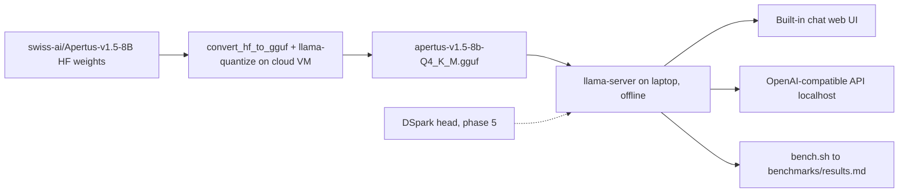

# Architecture

## Components

| Component | Role | Where it runs |
| --- | --- | --- |
| `swiss-ai/Apertus-v1.5-8B` (Hugging Face) | Source weights, BF16 safetensors (gated) | downloaded on a cloud VM |
| `convert_hf_to_gguf.py` + `llama-quantize` (llama.cpp) | Convert to an F16 GGUF, then quantize to 4-bit (Q4_K_M, Q4_0) | cloud VM (the F16 file is about 16 GB) |
| `apertus-v1.5-8b-Q4_K_M.gguf` | The single file copied to the laptop (about 5 GB) | laptop |
| `llama-server` (llama.cpp) | Built-in chat web UI and OpenAI-compatible API on localhost | laptop, offline |
| `llama-bench` + `scripts/bench.sh` | Speed measurements, one row per run in `benchmarks/results.md` | laptop (and VM, labelled) |
| DSpark head (phase 5) | Speculative drafter running on the target model's hidden states | laptop, inside llama.cpp |

## Data flow

Only the GGUF file crosses from the VM to the laptop. Everything on the laptop runs
from local files; after setup, no network access is needed.

## Why llama.cpp

- It is the most mature CPU inference engine and supports 4-bit GGUF quantization
  with hand-tuned AVX2 / AVX-512 kernels, which is what the i5-1135G7 offers.
- `llama-server` ships a chat web UI and an OpenAI-compatible API in one binary, so
  workshop participants need no extra software.
- It has an `apertus` architecture (added for Apertus v1, including the xIELU
  activation and QK-norm). Whether v1.5 maps onto it cleanly is checked in phase 2.
- `llama-bench` gives reproducible prompt and generation throughput numbers.

## Where DSpark plugs in

DSpark is a head-style drafter: it reads the target model's hidden states and proposes
the next few tokens, which the target then verifies in one batched forward pass.
llama.cpp's built-in `--model-draft` only supports a separate draft model, so phase 5
ports the head into llama.cpp:

1. expose the target model's last hidden states after each forward pass;
2. run the head as a small ggml graph on those states to draft tokens;
3. verify the drafted tokens with the target and accept the longest matching prefix.

The serving path (`llama-server`) stays the same; the head is an extra file loaded next
to the GGUF. Before porting, check whether recent llama.cpp already has an EAGLE-style
head drafter to build on.

## References

- Digital Pathlines, [Shrinking Apertus 1.5 8B for an 8 GB Laptop GPU](https://digitalpathlines.ch/2026/08/12/shrinking-apertus-1-5-8b-for-an-8-gb-laptop-gpu/)
  (Aug 2026). A GPU + vLLM deployment, so its numbers are not directly comparable to
  this CPU + llama.cpp setup. What we take from it:
  - v1.5 is a new, multimodal architecture (vision and audio tokenizers). Stock runtimes
    do not support it; Swiss AI ships a patched vLLM image
    (`ghcr.io/swiss-ai/vllm_apertus_1.5_release`). Its modeling code is the reference
    implementation for our text-only conversion, and logits are compared against it.
  - Text-only use: we extract only the language model into the GGUF.
  - The vocabulary is untied: 266,752 embedding rows and 131,072 output-head rows. The
    output head is read on every generated token, so it stays at Q6_K or better
    (llama.cpp's Q4_K_M already does this); 4-bit embedding and head cost them 6 to 11%
    on agent benchmarks.
  - Speed: 5 to 5.6 tok/s with about 4B parameters offloaded to system RAM, in line with
    our 6 to 8 tok/s CPU estimate.
  - Long prompts are slow (30K tokens took 199 s even partly on GPU): keep the default
    context at 4K to 8K tokens.
  - Native tool calling was weak; chat, translation and document Q&A worked well. The
    workshop demo shows chat and document Q&A.
  - They hit a server deadlock likely caused by a dependency mismatch: pin the
    llama.cpp commit and test a long run of requests before the workshop.
